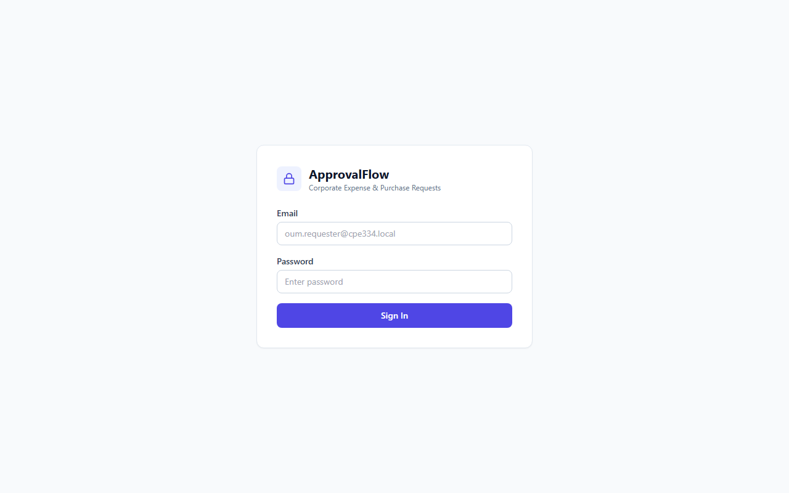
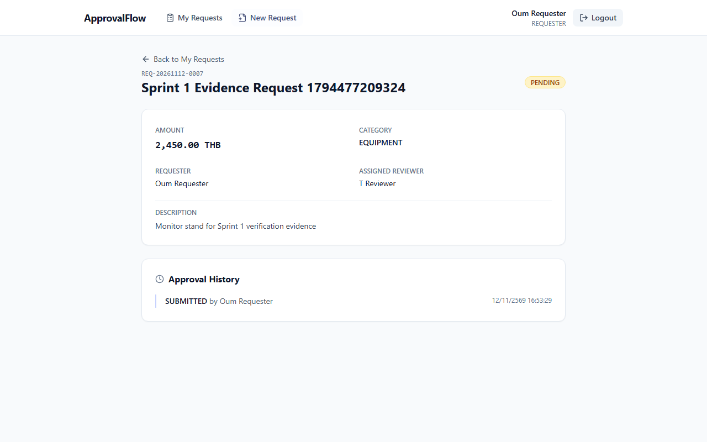
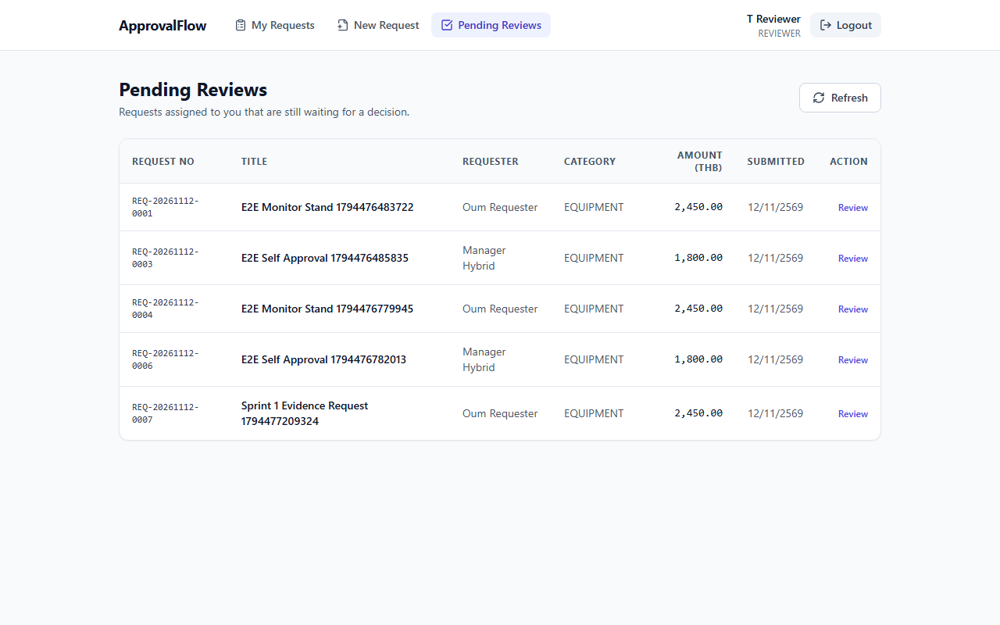
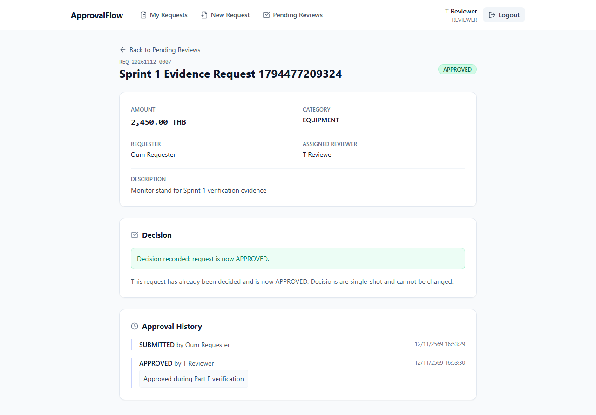
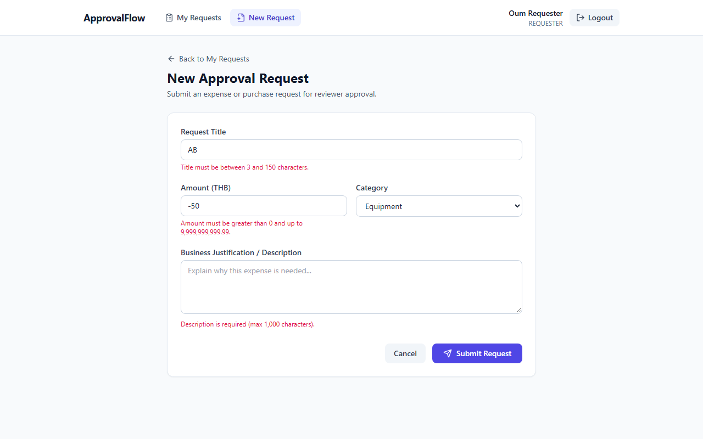
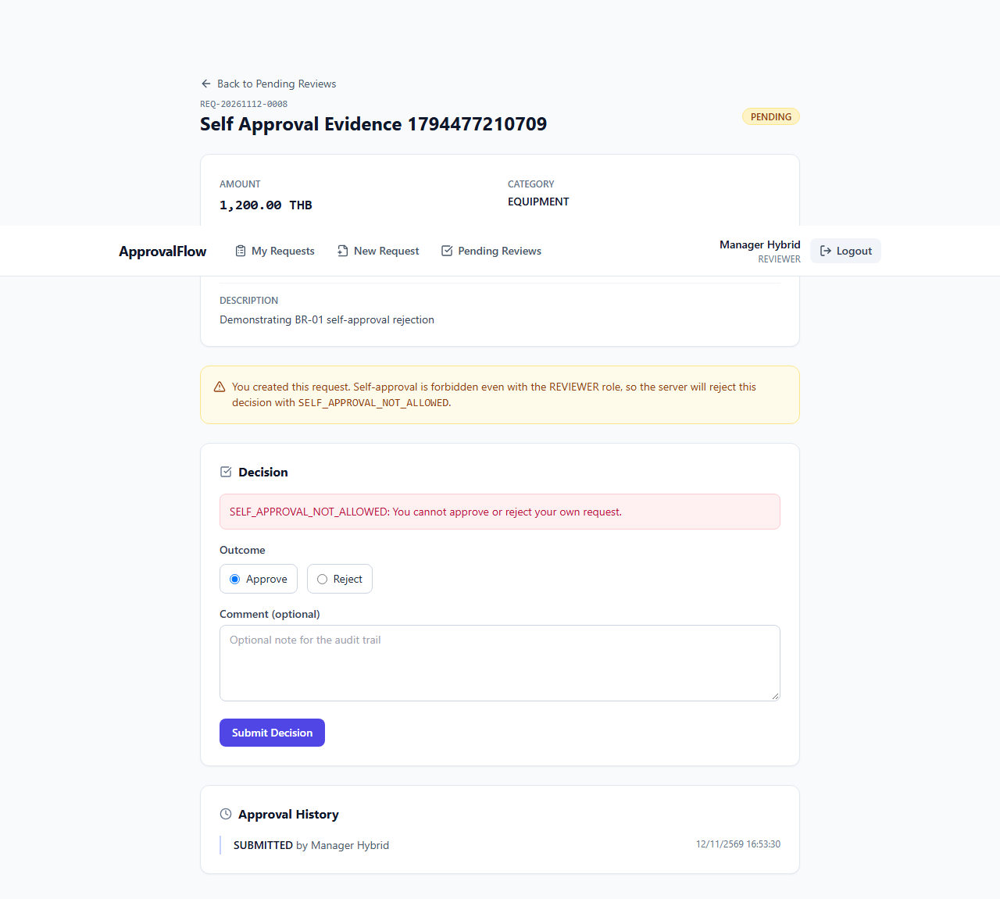

# Sprint 1 Verification & Evidence Package (Part F)

> **Deliverable:** CPE 334 Group Project Deliverable 1 — Part F
> **Project:** Corporate Expense & Purchase Request Approval System (`ssiriwan/cpe334-approval-system`)
> **Issue:** #6 — `[Part F] Sprint 1 verification and evidence package`
> **Verified Commit:** `2bcbf4a` (`sprint-1-staging`, post-PR #16 merge)
> **Authors:** Oum (67070501075, `@ssiriwan`) & T (67070501021, `@thhanabun`)
> **Verification Date:** 2026-11-12 (re-verified 2026-11-13 by T on a clean database)

---

## 1. Setup Summary

- **Architecture:** TypeScript monorepo (`client/` React + Vite, `server/` Express + Prisma ORM, `prisma/` PostgreSQL 17 schema & seed).
- **Local Verification Stack:**
  - PostgreSQL 17 running in Docker (`localhost:5434`, database `approval_db`)
  - Schema & Seed: `npx prisma migrate deploy --schema=prisma/schema.prisma` + `npm run prisma:seed` (3 demo accounts: `oum.requester@cpe334.local`, `t.reviewer@cpe334.local`, `manager.hybrid@cpe334.local`)
  - Vitest Workspace (`vitest.config.ts` with `fileParallelism: false` to prevent shared-DB race conditions)
  - Playwright Chromium (`e2e/*.spec.ts`) starting `npm run dev:server` (`:3000`) and `npm run dev:client` (`:5173`)

---

## 2. Build & Automated Test Results (Commit `2bcbf4a`)

| Check | Command | Result | Duration |
| :--- | :--- | :--- | :---: |
| **DB Migration & Seed** | `npx prisma migrate deploy --schema=prisma/schema.prisma && npm run prisma:seed` | **Pass** (1 migration applied, 3 demo accounts seeded) | - |
| **Unit / API / DB Suite** | `npx vitest run --config vitest.config.ts --reporter=verbose` | **7 files passed (7) \| 34 tests passed (34) \| 0 failed \| 0 skipped** | 27.40s |
| **Production Build** | `npm run build` (`tsc -b && vite build` + `tsc -p tsconfig.json`) | **Pass** (client bundle + server JS compiled cleanly) | 2.94s+ |
| **E2E Suite (Chromium)** | `npx playwright test --reporter=list` | **3 passed (3) \| 0 failed \| 0 skipped** (`E2E-01`, `E2E-02`, `E2E-03`) | 11.7s |
| **GitHub Actions CI** | Workflow `CI and Docker` (Run [`43193876219`](https://github.com/ssiriwan/cpe334-approval-system/actions/runs/43193876219)) | **Success** (migrate, seed, 34 tests, build, Docker build & `/api/health` smoke test) | 1m49s |
| **Re-verification by reviewer (T)** | `npx prisma migrate deploy` + `npm run prisma:seed` + `npm test` on a fresh PostgreSQL 17 volume | **Pass** (1 migration applied, 3 demo accounts seeded, **7 files / 34 tests passed**) | 79.86s |

---

## 3. Acceptance Criteria → Test Traceability Matrix

Every Sprint 1 Acceptance Criterion (`AC-AUTH-01..05` and `AC-01..12`) is mapped to executed automated tests on commit `2bcbf4a`:

| AC ID | Feature / Rule | Test ID | Test File & Case Name | Result | Commit |
| :--- | :--- | :--- | :--- | :---: | :---: |
| **AC-AUTH-01** | F-01 Login | `TEST-AUTH-01` | `server/tests/auth.test.ts` — `TEST-AUTH-01: logs in with valid credentials and sets an httpOnly cookie` | Pass | `2bcbf4a` |
| **AC-AUTH-02** | F-01 Invalid Login | `TEST-AUTH-02` | `server/tests/auth.test.ts` — `TEST-AUTH-02: rejects wrong passwords and unknown users without setting a cookie` | Pass | `2bcbf4a` |
| **AC-AUTH-03** | F-01 Session / Logout | `TEST-AUTH-03` | `server/tests/auth.test.ts` — `TEST-AUTH-03: rejects unauthenticated /me, returns current user, and clears the session on logout` | Pass | `2bcbf4a` |
| **AC-AUTH-04** | F-01 Role Guard | `TEST-AUTH-04` | `server/tests/auth.test.ts` — `TEST-AUTH-04: allows REVIEWER and rejects REQUESTER on a reviewer-only route` | Pass | `2bcbf4a` |
| **AC-AUTH-05** | F-01 / NFR-01 Security | `TEST-AUTH-05` | `server/tests/auth.test.ts` — `TEST-AUTH-05: stores bcrypt cost 12 and issues an 8-hour JWT without leaking secrets` | Pass | `2bcbf4a` |
| **AC-01** | F-02 / BR-05 Create & Assign | `TEST-01` | `server/tests/requests.test.ts` — `TEST-01: creates a PENDING request with requestNo, assigned reviewer, and SUBMITTED history` (+ `E2E-01`) | Pass | `2bcbf4a` |
| **AC-02** | F-02 / BR-04 Validation | `TEST-02` | `server/tests/requests.test.ts` — `TEST-02: rejects invalid payloads and boundary violations without persisting records` | Pass | `2bcbf4a` |
| **AC-03** | F-03 My Requests | `TEST-03` | `server/tests/requests.test.ts` — `TEST-03: returns only the authenticated user requests ordered newest first` | Pass | `2bcbf4a` |
| **AC-04** | F-03 / BR-03 Isolation & Persistence | `TEST-04`, `E2E-01` | `server/tests/requests.test.ts` — `TEST-04: enforces data isolation on GET /api/requests/:id`; `e2e/requester.spec.ts` — `E2E-01` | Pass | `2bcbf4a` |
| **AC-05** | F-04 / BR-05 Pending Queue | `TEST-05` | `server/tests/review.test.ts` — `TEST-05: returns only PENDING requests assigned to the current reviewer` | Pass | `2bcbf4a` |
| **AC-06** | F-04 / F-05 Approve & Reject | `TEST-06`, `TEST-07`, `E2E-02` | `server/tests/review.test.ts` — `TEST-06`, `TEST-07`; `e2e/reviewer.spec.ts` — `E2E-02` | Pass | `2bcbf4a` |
| **AC-07** | F-04 / BR-01 No Self-Approval | `TEST-08`, `E2E-03` | `server/tests/review.test.ts` — `TEST-08: blocks self-approval before the assignment check (BR-01)`; `e2e/reviewer.spec.ts` — `E2E-03` | Pass | `2bcbf4a` |
| **AC-08** | F-04 / BR-02 Lifecycle | `TEST-09` | `server/tests/review.test.ts` — `TEST-09: rejects a second decision with INVALID_STATE_TRANSITION and appends no history` | Pass | `2bcbf4a` |
| **AC-09** | F-04 / BR-05 Assigned Only | `TEST-11` | `server/tests/review.test.ts` — `TEST-11: rejects an unrelated reviewer with ACCESS_DENIED` | Pass | `2bcbf4a` |
| **AC-10** | F-04 Role Enforcement | `TEST-10` | `server/tests/review.test.ts` — `TEST-10: rejects a REQUESTER calling the review endpoint with FORBIDDEN` | Pass | `2bcbf4a` |
| **AC-11** | F-05 / BR-06 Append-Only History | `TEST-13` | `server/tests/review.test.ts` — `TEST-13: keeps history append-only and exposes no update/delete route` (+ manual restart check) | Pass | `2bcbf4a` |
| **AC-12** | F-04 / BR-07 Decision Payload | `TEST-12` | `server/tests/review.test.ts` — `TEST-12: validates the decision payload without changing the request` | Pass | `2bcbf4a` |

*Additional automated checks passing on `2bcbf4a`: `server/tests/health.test.ts` (2/2: `/api/health` 200 and `/api/*` 404 JSON envelope), `client/src/App.test.tsx` (1/1), `client/src/pages/Requests.test.tsx` (3/3), `client/src/pages/Reviews.test.tsx` (3/3).*

---

## 4. Three Demonstration Scenarios

### Scenario 1: Normal End-to-End Journey (UI → API → DB → Retrieval)
- **Feature / AC IDs:** `F-01`, `F-02`, `F-03`, `F-04`, `F-05` (`AC-01`, `AC-03`, `AC-04`, `AC-05`, `AC-06`)
- **Roles:** `Oum Requester` (`REQUESTER`), `T Reviewer` (`REVIEWER`)
- **Preconditions:** PostgreSQL seeded with demo users; server and client running (`playwright.config.ts`).
- **Steps:**
  1. Requester logs in via `/login` (`POST /api/auth/login`), lands on `/requests/my`, navigates to `/requests/new`, and submits an `EQUIPMENT` request (`1800` THB).
  2. Browser redirects to `/requests/:id`, displays `PENDING` status and `SUBMITTED` history; reloading the page confirms PostgreSQL persistence (`E2E-01`).
  3. Requester logs out; `T Reviewer` logs in, lands on `/reviewer/pending`, opens the assigned request, selects `Approve` with comment `"Approved for project use"`, and submits (`POST /api/requests/:id/review`).
  4. Navigate back to `/reviewer/pending` (`E2E-02`).
- **Expected & Actual Result:** `E2E-01` (2.7s) and `E2E-02` (1.6s) passed. Status updated to `APPROVED`, `APPROVED by T Reviewer` history appended in one transaction, and the request left the pending queue.
- **Evidence Screenshots:**
  - 
  - 
  - 
  - 

### Scenario 2: Business-Rule & Boundary Rejection (`BR-02`, `BR-04`, `BR-07`)
- **Feature / AC IDs:** `F-02`, `F-04` (`AC-02`, `AC-08`, `AC-12`)
- **Roles:** `REQUESTER`, `REVIEWER`
- **Preconditions:** Authenticated session cookie; existing `APPROVED` request for double-decision test.
- **Steps:**
  1. `POST /api/requests` with negative/zero amount, >2 decimal places, 2-char title, unknown category, or extra unknown keys (`TEST-02`).
  2. `POST /api/requests/:id/review` with invalid `decision: "ESCALATE"`, lowercase `"approve"`, `REJECT` with `<3` char comment, or `>500` char comment (`TEST-12`).
  3. `POST /api/requests/:id/review` on an already `APPROVED` request (`TEST-09`).
- **Expected & Actual Result:** All invalid payloads returned `400 VALIDATION_ERROR` and double-decision returned `400 INVALID_STATE_TRANSITION` with zero records created or modified in PostgreSQL (`TEST-02`, `TEST-09`, `TEST-12` all passed).
- **Evidence Screenshot:**
  - 

### Scenario 3: Forbidden & Unauthenticated Access Control (`BR-01`, `BR-03`, `BR-05`)
- **Feature / AC IDs:** `F-01`, `F-03`, `F-04` (`AC-AUTH-03`, `AC-AUTH-04`, `AC-04`, `AC-07`, `AC-09`, `AC-10`)
- **Roles:** Unauthenticated client, `REQUESTER`, `Manager Hybrid` (`REVIEWER`)
- **Preconditions:** Request owned by `Oum Requester` assigned to `T Reviewer`; `EQUIPMENT` request owned by `Manager Hybrid` assigned to `T Reviewer`.
- **Steps & Actual Results:**
  1. **Unauthenticated & Post-Logout:** Calling `/api/auth/me`, `POST /api/requests`, `/api/requests/pending`, or `/api/requests/:id` without cookie or after `POST /api/auth/logout` → **`401 UNAUTHORIZED`** (`TEST-AUTH-03`, `TEST-04`, `review.test.ts`).
  2. **Role Enforcement:** `REQUESTER` calling `POST /api/requests/:id/review` or `GET /api/requests/pending` → **`403 FORBIDDEN`** (`TEST-AUTH-04`, `TEST-10`).
  3. **Cross-User / Unrelated Reviewer:** Unrelated requester reading `GET /api/requests/:id` (`TEST-04`) or `Manager Hybrid` reviewing a request assigned to `T Reviewer` (`TEST-11`) → **`403 ACCESS_DENIED`**.
  4. **Self-Approval Guard (`BR-01`):** `Manager Hybrid` attempting to approve their own `EQUIPMENT` request (even though assigned to `T Reviewer`) → **`403 SELF_APPROVAL_NOT_ALLOWED`** before assignment check (`TEST-08`, `E2E-03` passed).
- **Evidence Screenshot:**
  - 

---

## 5. Actual Test Excerpts (Executed on `2bcbf4a`)

### Excerpt 1: Domain Rule `BR-01` — No Self-Approval (`server/tests/review.test.ts:226-256`)
Result: **Passed** (`395ms` in `vitest run` on `2bcbf4a`)

```ts
  it('TEST-08: blocks self-approval before the assignment check (BR-01)', async () => {
    const cookieM = await loginCookie(REVIEWER_M_EMAIL);

    // manager.hybrid owns an EQUIPMENT request, which is assigned to t.reviewer.
    const ownRequest = await createRequest(cookieM, {
      title: 'My Own Equipment Request',
      category: 'EQUIPMENT',
    });

    const dbBefore = await prisma.approvalRequest.findUnique({
      where: { id: ownRequest.id },
      include: { histories: true },
    });
    expect(dbBefore?.assignedReviewerId).toBe(reviewerTId);
    expect(dbBefore?.histories).toHaveLength(1);

    const res = await request(app)
      .post(`/api/requests/${ownRequest.id}/review`)
      .set('Cookie', cookieM)
      .send({ decision: 'APPROVE', comment: 'Self approval attempt' });

    expect(res.status).toBe(403);
    expect(res.body.error.code).toBe('SELF_APPROVAL_NOT_ALLOWED');

    const dbAfter = await prisma.approvalRequest.findUnique({
      where: { id: ownRequest.id },
      include: { histories: true },
    });
    expect(dbAfter?.status).toBe(RequestStatus.PENDING);
    expect(dbAfter?.histories).toHaveLength(1);
  });
```

### Excerpt 2: Access Restriction `BR-03` / `BR-05` — Unrelated Reviewer Blocked (`server/tests/review.test.ts:311-333`)
Result: **Passed** (`749ms` in `vitest run` on `2bcbf4a`)

```ts
  it('TEST-11: rejects an unrelated reviewer with ACCESS_DENIED', async () => {
    const cookieRequester = await loginCookie(REQUESTER_EMAIL);
    const cookieM = await loginCookie(REVIEWER_M_EMAIL);
    const created = await createRequest(cookieRequester, {
      title: 'Not Assigned To M',
      category: 'EQUIPMENT',
    });

    const res = await request(app)
      .post(`/api/requests/${created.id}/review`)
      .set('Cookie', cookieM)
      .send({ decision: 'APPROVE', comment: 'Unrelated reviewer attempt' });

    expect(res.status).toBe(403);
    expect(res.body.error.code).toBe('ACCESS_DENIED');

    const dbRequest = await prisma.approvalRequest.findUnique({
      where: { id: created.id },
      include: { histories: true },
    });
    expect(dbRequest?.status).toBe(RequestStatus.PENDING);
    expect(dbRequest?.histories).toHaveLength(1);
  });
```

---

## 6. TDD Red → Green Evidence

| Slice / Issue | Contract Commit | Red Test Commit | Green Implementation Commit | Merge PR |
| :--- | :--- | :--- | :--- | :---: |
| **F-01 Auth (#3)** | `fc8f548` (2026-11-10) `Contract E0` | `66f13e0` (2026-11-10) `TEST-AUTH-01..05` | `d458119` (2026-11-10) + `0faa578` (2026-11-11) | PR #12 (`ad10d0b`) |
| **F-02/F-03 Requester (#4)** | `bb4251b` (2026-11-11) `Contract E1` | `d80cc44` (2026-11-11) `TEST-01..04` | `331294f` + `37a343b` (2026-11-11) | PR #15 (`fd0c875`) |
| **F-04/F-05 Reviewer (#5)** | `4d3731a` (2026-11-12) `Contract E2` | `2c74f2c` (2026-11-12) `TEST-05..13` | `4f5b2a9` (2026-11-12) | PR #16 (`2bcbf4a`) |

---

## 7. Governance, Contribution & Honest Disclosure

### Issue -> Branch -> PR -> Reviewer -> Merge Commit
Every change reached `sprint-1-staging` through a reviewed pull request with no author self-approval:

| Issue | Scope | Branch | PR | Author | Reviewer | Merge commit |
| :---: | :--- | :--- | :---: | :---: | :---: | :---: |
| #8 | Monorepo scaffold, tooling, base branches | `chore/8-repo-scaffold` | #9 | Oum | T | `caa56c7` |
| #1 | Part A/B SRS, feature inventory, traceability | `feature/1-baseline-docs` | #11 | Oum | T | `ffcb38b` |
| #2 | Part C/D system SDS and three-sprint plan | `feature/2-system-sds-sprint-plan` | #10 | T | Oum | `cf5d4da` |
| #3 | F-01 auth foundation (schema, seed, login/logout/me) | `feature/3-auth-foundation` | #12 | T | Oum | `ad10d0b` |
| #13 | Lab 5 Docker image, CI quality gate, Cloud Run pipeline | `feature/13-lab5-docker-cicd` | #14 | T | Oum | `001cb0c` |
| #4 | F-02/F-03 requester slice | `feature/4-requester-slice` | #15 | Oum | T | `fd0c875` |
| #5 | F-04/F-05 reviewer slice | `feature/5-reviewer-slice` | #16 | T | Oum | `2bcbf4a` |
| #6 | Part F Sprint 1 verification and evidence package | `test/6-sprint1-verification` | #17 | Oum | T | merge of PR #17 |

- **Peer Review Rule:** Zero self-approvals; every PR was reviewed and approved by the non-author teammate (`docs/reviewer.md`).
- **Release:** Issue #7 opens the release PR `sprint-1-staging -> main` and tags `v0.1.0-sprint1` after PR #17 merges.

### Contribution Table
| Member | Student ID | Primary Ownership | Peer Review Ownership |
| :--- | :---: | :--- | :--- |
| **Oum** (`@ssiriwan`) | `67070501075` | Repo scaffold (#8), Part A/B SRS & Traceability (#1), F-02/F-03 Requester Slice (#4), Part F Verification (#6) | Reviewed PR #10, PR #12, PR #14, PR #16 |
| **T** (`@thhanabun`) | `67070501021` | Part C/D SDS & 3-Sprint Plan (#2), F-01 Auth Foundation (#3), Lab 5 Docker/CI/CD (#13), F-04/F-05 Reviewer Slice (#5) | Reviewed PR #9, PR #11, PR #15 |

### AI-Use Declaration
AI coding assistants were used to accelerate boilerplate scaffolding, test case drafting, and documentation formatting. All architecture decisions, business-rule enforcement orders, database schemas, and test verifications were reviewed, executed locally and in CI, and peer-reviewed by both team members.

### Known Limitations & Honest Disclosure
1. **Deferred Sprint 2 / Sprint 3 Scope:** `FR-07` (Return for Revision), `FR-08` (Multi-stage Approval), `FR-09` (Attachments), `FR-10` (Search/Filter/Reporting), and `FR-11` (Admin User/Role Management) are intentionally out of Sprint 1 scope and remain *Planned* for Sprints 2–3.
2. **NFR-02 Load Benchmark:** Formal 50-concurrent-request p95 latency load testing is deferred to Sprint 3; Sprint 1 verified functional correctness and single-query/transactional indexing.
3. **Playwright E2E in CI:** `E2E-01..03` pass locally against PostgreSQL + Vite + Express (`3/3` in `11.7s`), while `.github/workflows/ci-docker.yml` currently runs the 34 Vitest unit/integration tests, TypeScript builds, and Docker container `/api/health` probe.
4. **Minor Sprint 1 Polish Backlog:** Contract E1 §2 mentions a `createdAt` column in `MyRequestsPage` that is not rendered in the Sprint 1 table; `requestNo` uses a UTC date prefix (`YYYYMMDD`); category-to-reviewer mapping (`D-03`) is static until Sprint 3 Admin Management (`FR-11`).
